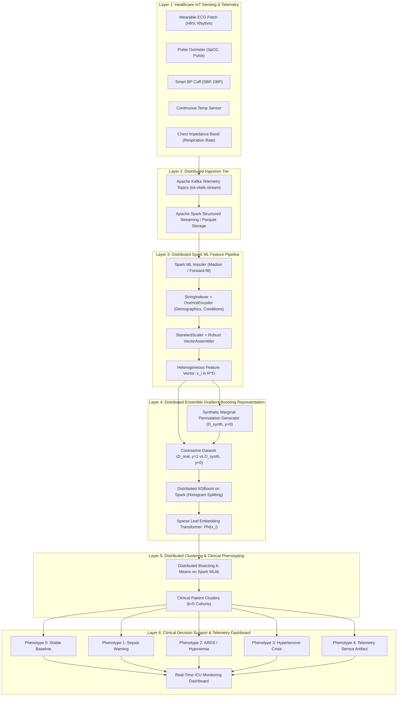
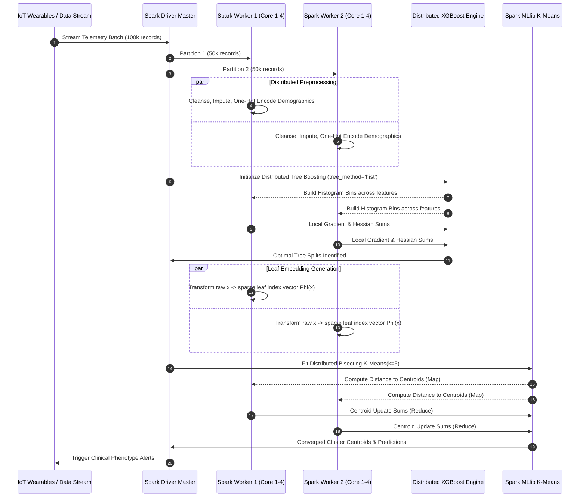

# Distributed System Architecture: Scalable Clustering of Heterogeneous Healthcare IoT Big Data

**Project Title:** Scalable Clustering of Heterogeneous Big Data via Distributed Ensemble Gradient-boosting Models (XGBoost on Spark/Dask), Applied to Healthcare IoT Patient Monitoring at Scale  
**Faculty Guide:** Ms. G. Hema Sri  
**Domain:** Big Data Analytics & Distributed Machine Learning  

---

## 1. High-Level End-to-End System Architecture

The following diagram illustrates the multi-tier streaming and batch architecture:

---

## 2. Distributed Execution Dataflow on Apache Spark

---

## 3. Clinical Phenotype Profiles (Cluster Taxonomy)

The 5 patient clusters represent clinically distinct physiological states:

| Cluster ID | Phenotype Name | Physiological Signature | Clinical Risk Level | Recommended Action |
|---|---|---|---|---|
| **0** | **Stable Baseline** | HR: 65–80 bpm, $SpO_2$: 97–99%, SBP: 110–125 mmHg, RR: 12–16 bpm, Temp: 36.6–37.2°C | Normal / Safe | Routine periodic monitoring (every 4 hours). |
| **1** | **Early Sepsis / Septic Shock** | HR: 110–145 bpm, Temp: >38.5°C or <36°C, RR: >24 bpm, SBP: <90 mmHg (hypotension) | **Critical (Emergency)** | Immediate SOFA evaluation, blood cultures, IV fluids, and broad-spectrum antibiotics. |
| **2** | **Acute Respiratory Distress (ARDS)** | $SpO_2 < 88\%$, RR: 28–38 bpm, HR: 105–125 bpm, Normal/Moderate BP | **High (Urgent)** | Supplemental oxygen therapy, mechanical ventilation assessment, arterial blood gas. |
| **3** | **Hypertensive Crisis / Cardiac Strain** | SBP > 180 mmHg, DBP > 110 mmHg, HR: 95–120 bpm, Low ECG HRV | **High (Urgent)** | Immediate IV antihypertensive administration, 12-lead ECG, troponin cardiac biomarkers. |
| **4** | **Telemetry Sensor Artifact** | SQI < 0.40, Erratic instantaneous jumps in vitals, high latency / packet loss | Non-clinical (Technical) | Alert nursing staff to reposition wireless sensors or replace electrodes. |

---

## 4. Hardware & Distributed Infrastructure Sizing

For deployment in a hospital data center or cloud environment:

- **Cluster Manager:** Apache Spark Standalone or Kubernetes (YARN optional)
- **Driver Node:** 4 vCPUs, 16 GB RAM
- **Worker Nodes:** Minimum 2 Nodes, each 8 vCPUs, 32 GB RAM, 10 Gbps interconnect
- **Storage:** HDFS or Apache Parquet on AWS S3 / Azure ADLS / Google Cloud Storage
- **Throughput Target:** > 50,000 telemetry events/sec at < 500 ms p99 latency
